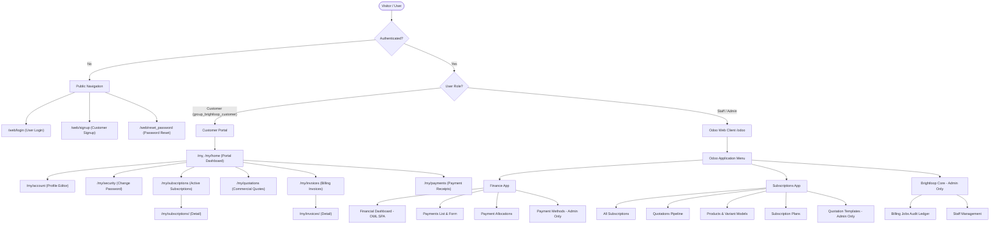
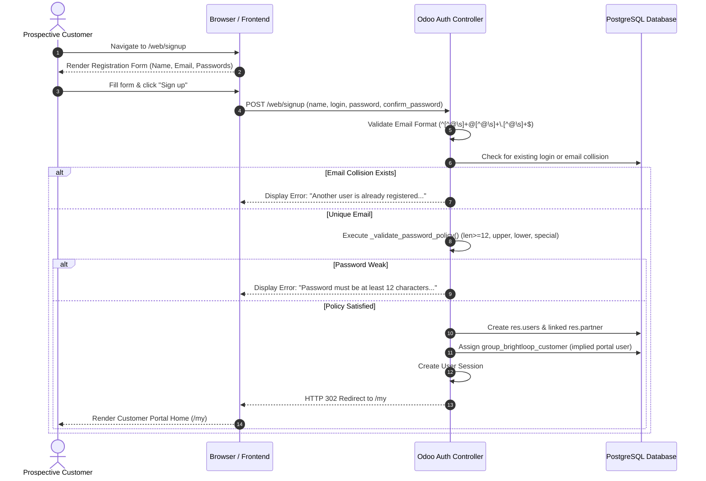
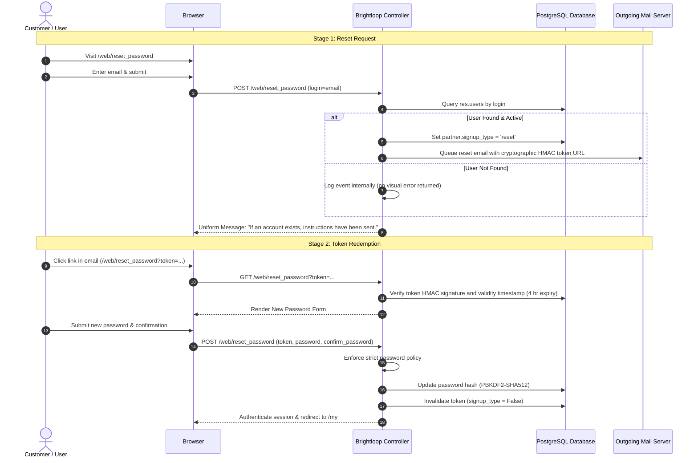
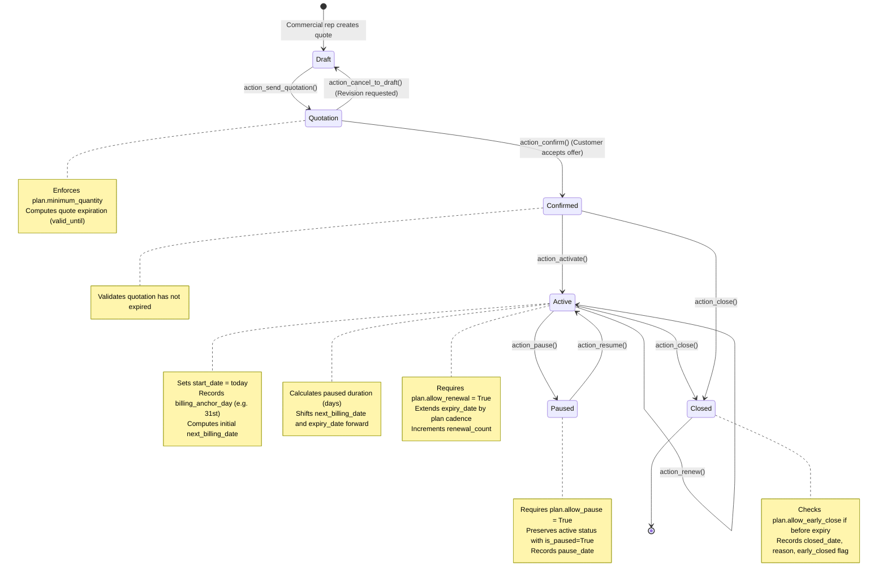
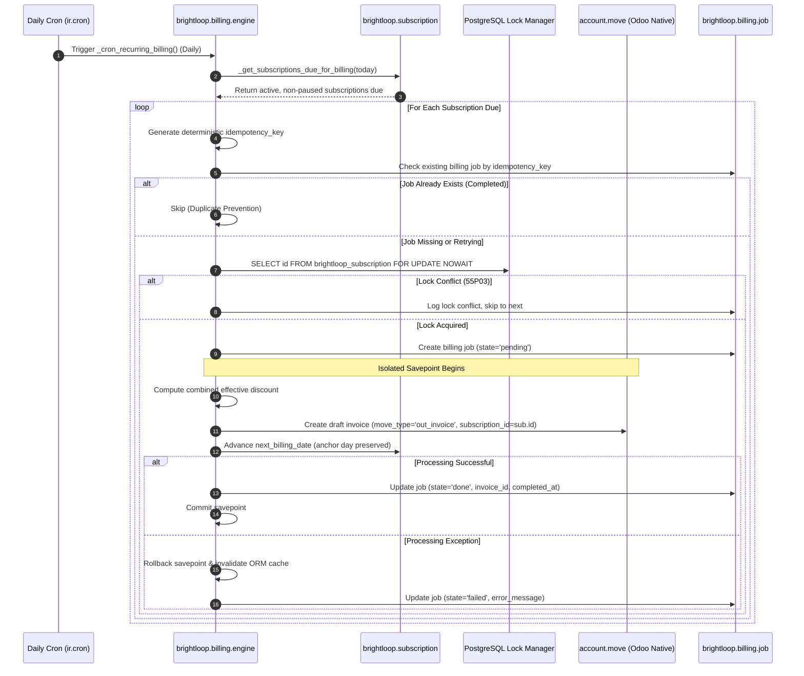
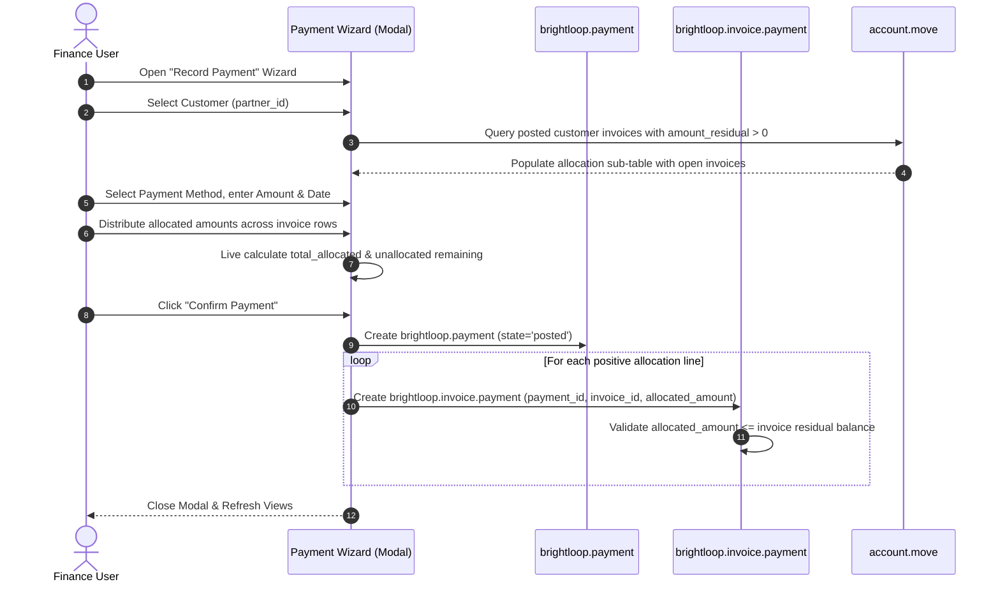

# USER FLOWS AND JOURNEYS: BRIGHTLOOP SUBSCRIPTION MANAGEMENT SYSTEM

> **Document Type:** Senior Architectural & UI/UX Audit — Document 05 / 08  
> **Auditor Role:** Senior UI/UX Auditor, Software Architect & Frontend Reverse Engineer  
> **Project Name:** Brightloop Subscription Management System  
> **Target Downstream Consumer:** Google Stitch AI (Frontend Reconstruction & Modernization)  
> **Repository Path:** `/Users/noelsabu/Documents/subcription_management_oduu /`  
> **Audit Date:** October 31, 2026

---

## 1. Global Navigation Architecture

The Brightloop platform provides two distinct user navigation domains governed by user security groups:



---

## 2. Customer Registration & Onboarding Journey



---

## 3. Two-Stage Password Reset Journey (Anti-Enumeration)



---

## 4. Subscription Commercial Lifecycle Journey



---

## 5. Automated Recurring Billing Engine Journey



---

## 6. Payment Recording & Multi-Invoice Allocation Journey



---

## 7. Financial Dashboard & XLSX Export Journey

```mermaid
sequenceDiagram
    autonumber
    actor Staff as Finance User / Manager
    participant DashboardUI as OWL 2 Component (Browser)
    participant RPC as JSON-RPC (/web/dataset/call_kw)
    participant DashModel as brightloop.finance.dashboard
    participant ExportModel as brightloop.finance.export
    participant XlsxWriter as xlsxwriter Engine

    Staff->>DashboardUI: Open Finance Dashboard
    DashboardUI->>RPC: get_dashboard_kpis(date_from, date_to)
    RPC->>DashModel: Instantiate transient record & _compute_kpis()
    DashModel->>DashModel: Aggregate allocations, residual balances, overdue counts via read_group()
    DashModel-->>RPC: Return { kpis: {...}, payments: [...] }
    RPC-->>DashboardUI: Reactive state updated; render 6 cards & collection progress bar

    Note over Staff,XlsxWriter: User Triggers Excel Export
    Staff->>DashboardUI: Click "Export to XLSX"
    DashboardUI->>RPC: export_xlsx(date_from, date_to)
    RPC->>ExportModel: Instantiate export wizard (export_type='full_report')
    ExportModel->>ExportModel: Enforce _check_report_access(partner_id)
    ExportModel->>XlsxWriter: Compile 6 formatted sheets (Payments, Invoices, Outstanding, Overdue, Revenue, Subscriptions)
    XlsxWriter-->>ExportModel: In-memory binary workbook
    ExportModel-->>RPC: Return { file_content: "<base64>", filename: "brightloop_finance_report.xlsx" }
    RPC-->>DashboardUI: Payload received
    DashboardUI->>DashboardUI: Convert Base64 -> Blob -> Create Anchor Tag -> Click Download
    DashboardUI-->>Staff: File downloaded to user's device + Success Toast displayed
```

