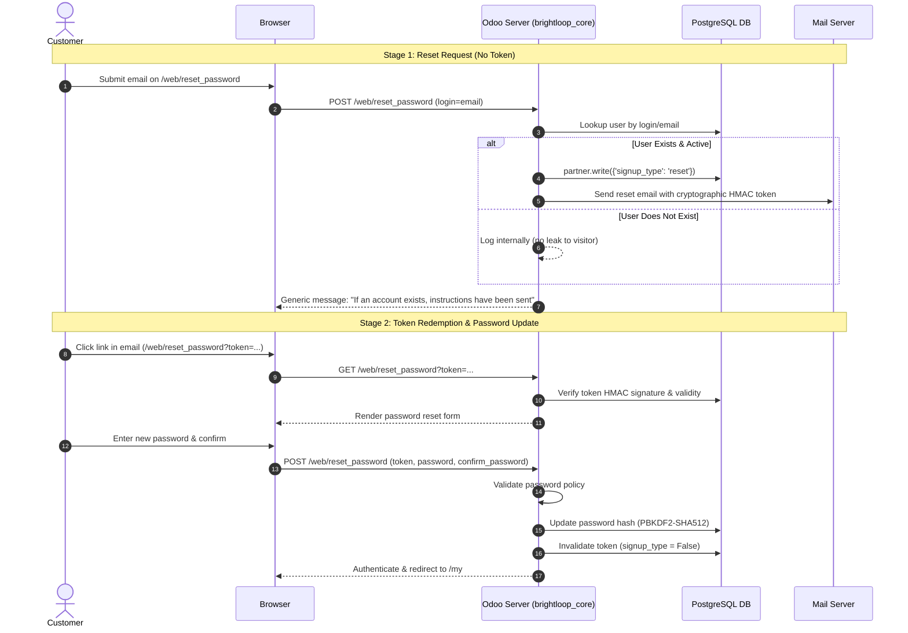

# Brightloop Subscription Management System — Authentication Specification

**Module:** `brightloop_core`  
**Workstream Lead:** Member 1 (Platform Foundation, Authentication & Security Lead)  
**Target Platform:** Odoo 18.0 Community / PostgreSQL 16 / Python 3.12  
**Implementation Phase:** Phase 4 (Customer Portal & Authentication Workflows)

---

## 1. Overview & Authentication Architecture

Brightloop leverages Odoo 18's native authentication architecture, extended with strict server-side validation, anti-enumeration protections, and automated customer role assignment.

All customer authentication is handled using standard session-based HTTP transactions. No external or non-standard token schemes (such as duplicate JWT architectures) are introduced, ensuring compatibility with standard Odoo web modules and portal controllers.

---

## 2. Customer Registration Flow (`/web/signup`)

### Endpoint & Access
- **URL Route:** `/web/signup`
- **Authentication Level:** `auth='public'`, `website=True`
- **Method:** `GET` (renders form), `POST` (submits registration)
- **CSRF Protection:** Native Odoo CSRF token verification on all POST requests

### Registration Parameters
| Field | Type | Requirement | Description |
| :--- | :--- | :--- | :--- |
| `name` | string | Mandatory | Customer's full name / organization name |
| `login` | string | Mandatory | Customer's email address (serves as primary login identifier) |
| `password` | string | Mandatory | Cleartext password (must satisfy strict password policy) |
| `confirm_password` | string | Mandatory | Must match `password` exactly |
| `csrf_token` | string | Mandatory | Anti-CSRF verification token |

### Server-Side Validation Pipeline
1. **Password Confirmation:** `password` must match `confirm_password` exactly; otherwise, raises `UserError("Passwords do not match; please retype them.")`.
2. **Email Format Validation:** Validated via regex pattern (`^[^@\s]+@[^@\s]+\.[^@\s]+$`). Malformed addresses are rejected with `UserError("Please provide a valid email address.")`.
3. **Duplicate Account Prevention:** Searches existing `res.users` records by `login` and `email`. If an existing user matches, rejected with `UserError("Another user is already registered using this email address.")`.
4. **Password Policy Enforcement:** Cleartext password is validated by `_validate_password_policy()`:
   - Length > 8 characters.
   - At least 1 uppercase letter (`[A-Z]`).
   - At least 1 lowercase letter (`[a-z]`).
   - At least 1 special character (`[^A-Za-z0-9]`).
5. **Privilege Escalation Defense:** Client requests cannot submit `groups_id` or `share` values. Any injected parameters are stripped in `_signup_create_user()` and guarded server-side in `res.users.create()`.
6. **Automatic Role Assignment:** The newly created user is automatically assigned the canonical `brightloop_core.group_brightloop_customer` security group, establishing the customer role and linking to their `res.partner` identity.

---

## 3. Password Reset Flow (`/web/reset_password`)

### Endpoint & Access
- **URL Route:** `/web/reset_password`
- **Authentication Level:** `auth='public'`, `website=True`
- **Method:** `GET` / `POST`

### Two-Stage Workflow


### Security Properties
1. **Anti-Enumeration Protection:**  
   Standard Odoo displays `"No account found for this login"` when an unregistered email is submitted. Brightloop overrides `web_auth_reset_password` to return a uniform message:  
   `"If an account exists for this email address, password reset instructions have been sent."`
2. **Cryptographic Token Lifecycle:**  
   Tokens are generated using Odoo's HMAC signing (`tools.hash_sign`) over payload `[partner_id, user_ids, last_login_date, signup_type]`:
   - Valid for 4 hours by default (`auth_signup.reset_password.validity.hours`).
   - Automatically invalidated if the user logs in before token use (login timestamp changes).
   - Invalidation on redemption: `partner.write({'signup_type': False})` immediately revokes the token upon successful password update, preventing token reuse.
3. **Password Hashing:** Compliant passwords are encrypted using native Passlib `pbkdf2_sha512` (600,000 rounds).

---

## 4. Login, Session & Access Control

### Login (`/web/login`)
- Authenticates against credentials using `_check_credentials()`.
- Customer users are routed to `/my` upon successful login.
- Inactive/archived accounts (`active=False`) are rejected.
- Failed logins return standard `"Wrong login/password"` message.

### Session Termination (`/web/session/logout`)
- Destroys active session cookie on the server.
- Subsequent requests to protected routes (`/my`, `/my/account`) return HTTP 302 redirecting to `/web/login`.

### Route Authorization
| Route | Auth Mode | Permitted Roles | Failure Behavior |
| :--- | :--- | :--- | :--- |
| `/web/login` | `public` | All | Renders login page |
| `/web/signup` | `public` | Unauthenticated visitors | Renders signup page |
| `/web/reset_password` | `public` | Unauthenticated visitors | Renders reset page |
| `/my`, `/my/home` | `user` | Authenticated customers, staff, admins | 302 Redirect to `/web/login` |
| `/my/account` | `user` | Authenticated customers | 302 Redirect to `/web/login` |
| `/my/subscriptions` | `user` | Authenticated customers | 302 Redirect to `/web/login` |
| `/my/quotations` | `user` | Authenticated customers | 302 Redirect to `/web/login` |
| `/my/invoices` | `user` | Authenticated customers | 302 Redirect to `/web/login` |
| `/my/payments` | `user` | Authenticated customers | 302 Redirect to `/web/login` |
| `/odoo`, `/web` | `user` (internal) | Staff (`group_user`), Admin (`group_erp_manager`) | Portal users redirected to `/my` |

---

## 5. System Configuration & Requirements

The following system parameters are configured by `brightloop_core`:

```xml
auth_signup.invitation_scope = b2c
auth_signup.reset_password = True
```

### Outgoing Email Server (Production Requirement)
In local development, outgoing emails are logged to the PostgreSQL `mail.message` / `mail.mail` queue. For production deployment, configure an active SMTP server under:  
**Settings → Technical → Outgoing Mail Servers**.

---

## 6. Automated HTTP Test Coverage

All 25 HTTP integration tests in `addons/brightloop_core/tests/test_portal_http.py` pass cleanly:
- `TestCustomerRegistrationHttp`: 6 tests (success, weak password, mismatch, invalid email, duplicate email, privilege escalation).
- `TestPasswordResetHttp`: 5 tests (valid request, anti-enumeration, syntax validation, weak new password, valid token redemption & reuse prevention).
- `TestCustomerAuthSessionHttp`: 5 tests (login success, invalid credentials, inactive user, logout, protected route redirect).
- `TestCustomerPortalAndProfileHttp`: 6 tests (portal dashboard, placeholder routes, profile update, invalid email, duplicate email, IDOR protection).
- `TestAdminStaffManagementWorkflow`: 3 tests (action configuration, admin menu restriction, customer access denial).
