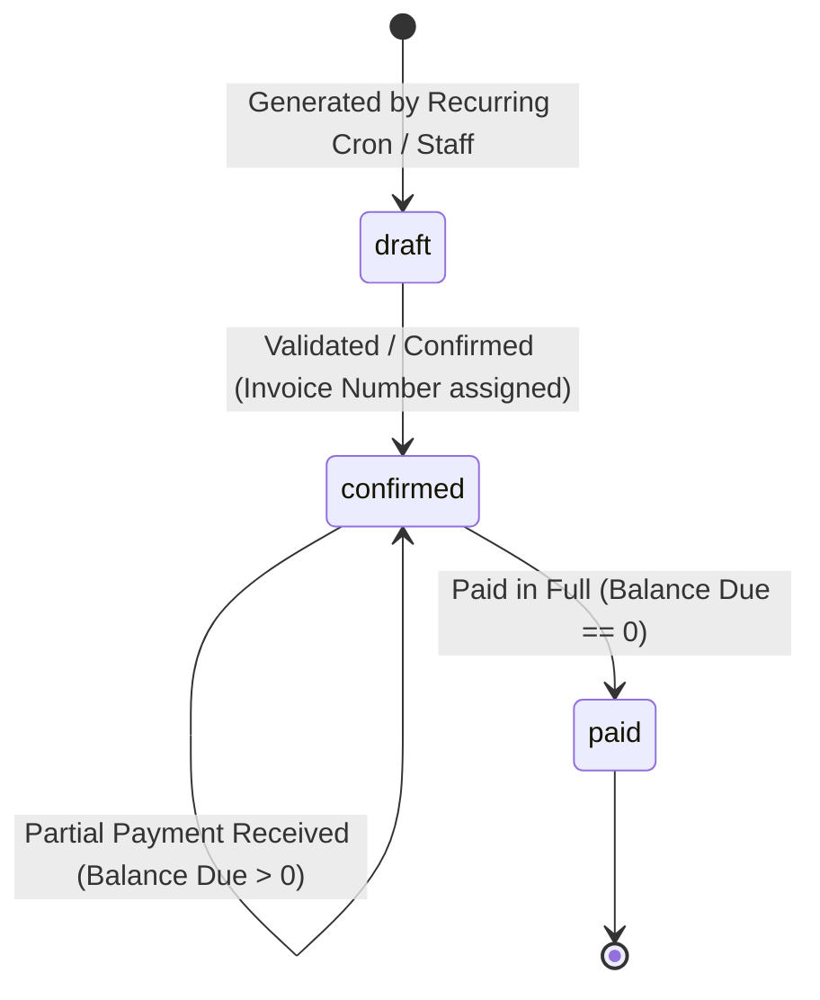
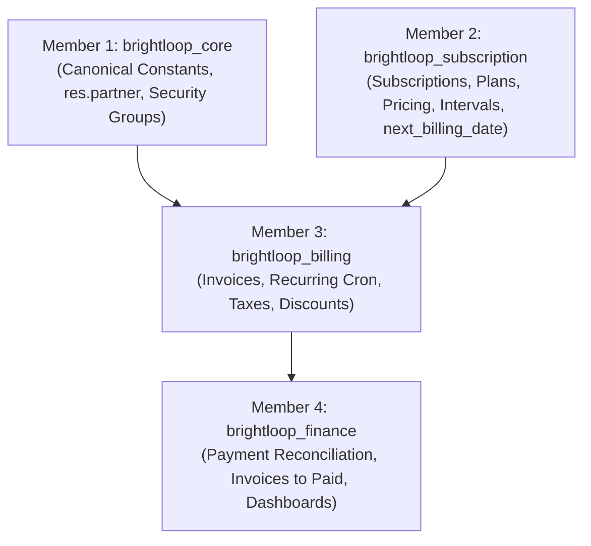
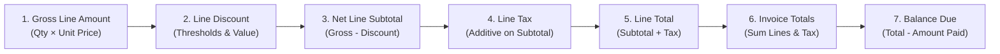
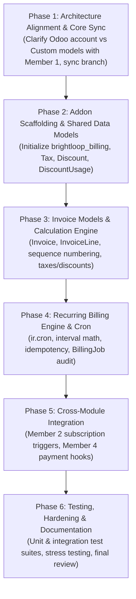

# Member 3 Technical Implementation Plan: Billing, Invoices, Taxes & Discounts

**Platform:** Brightloop Subscription Management System  
**Odoo Target Version:** Odoo 18.0 Community  
**Assigned Workstream:** Member 3 (`brightloop_billing`)  
**Git Branch:** `member-3`  
**Status:** Final Technical Specification & Architecture Plan  

---

## 1. Overview of the Billing Module

The `brightloop_billing` module serves as the financial transaction, pricing computation, and recurring billing engine of the Brightloop Subscription Management System. Operating within an Odoo 18 Community modular monolith architecture, the module translates subscription agreements into verified, auditable financial records.

The primary objectives of the module are:
1. **Automate Recurring Billing:** Execute autonomous, scheduled billing sweeps that evaluate subscription cycles and generate invoices on schedule without human intervention.
2. **Standardize Invoice Lifecycle:** Manage invoices strictly across canonical states (`draft`, `confirmed`, `paid`) defined in project-wide architecture contracts.
3. **Execute Fixed-Precision Financial Calculations:** Guarantee deterministic, multi-tier calculations for line item amounts, promotional discounts, and applicable taxes using fixed-precision decimal arithmetic to eliminate floating-point drift.
4. **Guarantee Billing Reliability & Idempotency:** Implement industrial-grade transactional boundaries, row-level database locking, and schema-level unique constraints with explicit idempotency keys to eliminate double-billing, race conditions, or partial batch failures.
5. **Seamless Cross-Module Collaboration:** Interface cleanly with `brightloop_core` (Member 1), `brightloop_subscription` (Member 2), and `brightloop_finance` (Member 4).

---

## 2. Responsibilities of Member 3

Member 3 owns end-to-end responsibility for the following functional domains:

1. **Invoice Management:**
   - Logical invoice and invoice line data structures conforming to shared Brightloop contracts.
   - Sequential, audit-compliant invoice numbering.
   - State transition enforcement adhering to `odoo.addons.brightloop_core.models.shared_constants`.
   - Customer (`res.partner`) and subscription relationship management.
   - Invoice validation, due date assignment, and balance tracking.

2. **Recurring Billing Engine:**
   - Automated cron runner (`ir.cron`) for scheduled subscription billing sweeps.
   - Calendar interval arithmetic across canonical intervals (`daily`, `weekly`, `monthly`, `yearly`).
   - Calculation of subscription period boundaries (`billing_period_start`, `billing_period_end`).
   - Atomic invoice generation and subscription `next_billing_date` advancement.
   - Batch isolation, idempotency enforcement, and execution audit logging (`BillingJob`).

3. **Tax Management:**
   - Tax definition models supporting percentage-based and fixed-amount levies (per-unit and per-line).
   - Multi-tax additive aggregation per invoice line using fixed-precision decimal arithmetic.

4. **Discount Management:**
   - Administrator-restricted configuration for percentage and fixed-amount discounts.
   - Minimum purchase and minimum quantity activation thresholds.
   - Validity date windows, global usage limits, and product/plan eligibility filters.
   - Audit logging and strict prevention of repeated discount consumption via `DiscountUsage`.

5. **Billing Reliability & Testing:**
   - Database transactional isolation (`savepoint`) ensuring atomic operations per subscription.
   - Row-level database locks (`SELECT ... FOR UPDATE NOWAIT`) preventing concurrent billing races.
   - Schema-level unique constraints and explicit `idempotency_key` verification.
   - Comprehensive automated test suite including mathematical accuracy, concurrency stress tests, and large-scale batch processing (hundreds of subscriptions).

---

## 3. Invoice Management Requirements

### 3.1 Canonical Status Lifecycle & Odoo 18 State Mapping
Invoices must strictly follow the canonical invoice states declared in `brightloop_core.models.shared_constants`:
- `draft`: Initial editable invoice state generated by the recurring billing engine or created manually by staff. Can be reviewed, modified, or discarded.
- `confirmed`: Validated, finalized invoice. Immutable financial document with an assigned invoice number and payable balance. Ready for payment collection.
- `paid`: Closed financial document indicating zero outstanding balance ($\text{balance\_due} \le 0.00$). Transitioned exclusively upon verified full payment receipt by Member 4 (`brightloop_finance`).



#### Mapping Between Odoo 18 `account.move` and Brightloop Canonical States
In Odoo 18, `account.move` decouples document posting workflow from payment reconciliation:
- **Posting Workflow (`state`):** Tracked by `state` (`'draft'`, `'posted'`, `'cancel'`).
- **Payment Reconciliation (`payment_state`):** Tracked by `payment_state` (`'not_paid'`, `'in_payment'`, `'paid'`, `'partial'`, `'reversed'`).

| Brightloop Canonical State | Odoo 18 `account.move.state` | Odoo 18 `account.move.payment_state` | Accounting & Business Meaning |
| :--- | :--- | :--- | :--- |
| `draft` | `'draft'` | `'not_paid'` | Unvalidated document; lines and taxes can still be modified. |
| `confirmed` | `'posted'` | `'not_paid'`, `'partial'`, or `'in_payment'` | Posted to ledger; journal entries created; formal sequence assigned; outstanding balance exists (`balance_due > 0.00`). **Partial or in-flight payments keep the invoice in this state.** |
| `paid` | `'posted'` | `'paid'` | Fully reconciled with payment transactions; zero balance remains. |

> [!NOTE]
> **Invoice Cancellation as an Operation:**
> Cancellation is an authorized administrative operation (e.g., discarding a draft or executing an administrative void/reversal), not an additional mandatory invoice status enum. The canonical statuses strictly adhere to `shared_constants.py` (`draft`, `confirmed`, `paid`).

> [!IMPORTANT]
> **Partial Payments Never Transition to Paid:**
> When a partial payment is applied ($0.00 < \text{amount\_paid} < \text{total}$, leaving $\text{balance\_due} > 0.00$), the invoice **strictly remains** in `confirmed` status (`payment_state == 'partial'`). An invoice transitions to `paid` if and only if $\text{balance\_due} \le 0.00$.

### 3.2 Invoice Business Rules
1. **Invoice Numbering:** A formal sequence number is assigned when an invoice transitions from `draft` to `confirmed`. Draft invoices maintain a provisional reference.
2. **Customer Linkage:** Every invoice must reference a valid customer entity (`customer_id` mapping to `res.partner`) provided by `brightloop_core`.
3. **Subscription Traceability:** Invoices generated through recurring billing must retain a direct foreign key reference to their originating subscription record (`subscription_id`).
4. **Due Date Calculation:** The `due_date` reflects the payment deadline.
5. **Immutability:** Once transitioned to `confirmed` or `paid`, invoice lines, taxes, and applied discounts cannot be modified or deleted.

### 3.3 Architectural Decisions Awaiting Member 1's Approval
> [!IMPORTANT]
> **Pending Architecture Sign-off from Member 1:**
> 1. **Invoicing Model Approach:**
>    - **Option A (Odoo Native Accounting):** Inherit and extend Odoo's standard `account.move` and `account.move.line`. Enables native integration with Odoo's journals, payment acquirers, and fiscal reporting. Requires declaring `'account'` in `depends` of `__manifest__.py`.
>    - **Option B (Lightweight Custom Billing Models):** Create dedicated models `brightloop.invoice` and `brightloop.invoice.line` independent of Odoo's accounting engine. Keeps the schema lean and decoupled from standard accounting configuration.
>    *(Member 3's logical contracts in Section 7 cleanly map to both options).*
> 2. **Invoice Numbering Sequence Policy:** Confirmation of whether numbering requires strict gap-free sequences or standard Odoo sequence generation with gap tolerance during rollbacks.
> 3. **Default Payment Terms Policy:** Confirmation of whether payment due dates default to the invoice date (immediate) or configurable payment terms (e.g., Net 15, Net 30).

---

## 4. Recurring Billing Requirements

### 4.1 Scheduled Execution (`ir.cron`)
- A background cron task (`ir.cron`) runs on a recurring schedule (e.g., once daily or configurable hourly).
- The cron worker queries subscriptions meeting all of the following criteria:
  1. `status == 'active'` (using `shared_constants.SUBSCRIPTION_STATUS_ACTIVE`).
  2. `next_billing_date <= current_date`.
  3. No in-flight or completed `BillingJob` exists for the target billing cycle.

### 4.2 Interval Calculation Logic
Billing intervals adhere to `shared_constants.BILLING_INTERVAL_*`:
- `daily`: `next_billing_date = current_billing_date + 1 day`
- `weekly`: `next_billing_date = current_billing_date + 7 days`
- `monthly`: `next_billing_date = current_billing_date + 1 month`
- `yearly`: `next_billing_date = current_billing_date + 1 year`

#### Calendar Edge-Case Handling:
- **Month-End Boundary:** When billing monthly on days 29, 30, or 31, if the target month has fewer days (e.g., Jan 31 -> Feb), the billing date snaps to the last valid day of that month (Feb 28 or Feb 29 in leap years), preserving the original anchor day for subsequent cycles where possible.
- **Leap Year Boundary:** Yearly subscriptions billed on Feb 29 roll to Feb 28 in non-leap years.

### 4.3 Billing Period Boundaries
Each billing execution defines an explicit accounting window:
- `billing_period_start`: Equal to the subscription's current `next_billing_date`.
- `billing_period_end`: Equal to the day prior to the newly advanced `next_billing_date`.

### 4.4 Atomic Invoice Generation & Date Advancement
- **Atomic Execution:** In a single database transaction, the recurring engine generates the invoice for the period and advances the subscription's `next_billing_date`.
- **Decoupled Confirmation:** Advancing `next_billing_date` must not wait for the invoice to reach `confirmed` or `paid` state unless explicitly required by integration contracts. If an invoice is generated in `draft` for review, the cycle date advances atomically upon creation to prevent re-billing the same cycle.
- **Integration Alignment with Member 2:** The exact target state of auto-generated invoices (`draft` vs automatically `confirmed`) is subject to integration approval from Member 2 and Member 1.

---

## 5. Tax Management Requirements

### 5.1 Tax Types & Configuration
Taxes must support standard commercial billing structures:
- **Percentage-Based Tax:** Applied as a percentage of the taxable base subtotal (e.g., 5%, 18%, 20%).
- **Fixed-Amount Tax:** A constant monetary charge applied per unit or per transaction line.

### 5.2 Application & Calculation Methods
- **Percentage Tax (Exclusive Baseline):**
  $$\text{tax\_amount} = \text{round\_decimal}\left(\text{subtotal} \times \frac{\text{tax\_rate}}{100}\right)$$
- **Fixed-Amount Tax Application:**
  - **Per-Unit Application (Standard Baseline):** Fixed levy applies to each unit billed on the invoice line:
    $$\text{tax\_amount} = \text{round\_decimal}(\text{quantity} \times \text{fixed\_amount})$$
  - **Per-Line Application (Flat Fee Option):** Fixed levy applies once to the entire line regardless of quantity:
    $$\text{tax\_amount} = \text{round\_decimal}(\text{fixed\_amount})$$
  - *Configuration:* Governed by the `fixed_application` attribute on the `Tax` model (`'per_unit'` vs `'per_line'`), defaulting to `'per_unit'`.
- **Tax Included (Subtractive/Embedded) — Proposed Approach:** Unit price includes tax; base and tax are extracted:
  $$\text{base} = \text{round\_decimal}\left(\frac{\text{gross\_amount}}{1 + \frac{\text{tax\_rate}}{100}}\right)$$
  $$\text{tax\_amount} = \text{gross\_amount} - \text{base}$$

### 5.3 Multi-Tax Aggregation & Precision
- Multiple taxes on a single line are calculated additively on the discounted net subtotal.
- All tax calculations use fixed-precision decimal arithmetic matching currency decimal precision (typically 2 decimal places).

### 5.4 Architectural Decisions Awaiting Member 1's Approval
> [!IMPORTANT]
> **Pending Confirmation from Member 1:**
> 1. **Tax Inclusion Policy:** Whether tax-inclusive pricing must be supported in the initial release or deferred in favor of tax-exclusive pricing.
> 2. **Compound Taxation:** Whether cascading/compound taxes (tax-on-tax) are required or strictly additive.

---

## 6. Discount Management Requirements

### 6.1 Administrator-Only Configuration & Access Control
- **Strict Role Restriction:** Only users with administrative privileges (`role == 'admin'`, belonging to `group_brightloop_admin`) are authorized to create, update, or archive discounts. Staff and Customers possess read-only or no access.

### 6.2 Discount Types & Thresholds
- **Percentage Discount:** Reduces eligible amounts by a specified percentage ($0.00 \le \text{value} \le 100.00$).
- **Fixed Amount Discount:** Reduces eligible amounts by a fixed monetary value. Cannot reduce a line subtotal below $0.00$.
  - `minimum_purchase`: Minimum monetary value required to activate the discount.
  - `minimum_quantity`: Minimum product item units required on the line/invoice.

### 6.3 Validity, Limits & Scope
- **Time Windows:** Governed by `start_date` and `end_date`. Inactive outside this window.
- **Global Usage Limit:** Governed by `usage_limit`. Once total redemptions reach `usage_limit`, further redemptions are rejected.
- **Target Scope:** Configured via `target_type` (`'all'`, `'specific_products'`, `'specific_plans'`), evaluated against `applicable_product_ids` or `applicable_plan_ids`.

### 6.4 Prevention of Repeated Discount Consumption
- Every discount redemption is recorded in a dedicated `DiscountUsage` log containing `discount_id`, `invoice_id`, `subscription_id`, `customer_id`, `applied_amount`, and `used_at`.
- The system checks `DiscountUsage` prior to invoice validation to verify that one-time promotional codes or per-customer limits cannot be re-applied or exploited across multiple invoices or concurrent requests.

### 6.5 Architectural Decisions Awaiting Member 1's Approval
> [!IMPORTANT]
> **Pending Confirmation from Member 1:**
> 1. **Discount Stacking Policy:** Whether line-level product discounts can stack with subscription/invoice-level promotional discounts, or if a strict "single highest discount" rule applies.
> 2. **Customer Redemption Limits:** Whether a per-customer usage cap is enforced at the discount model level in addition to global `usage_limit`.

---

## 7. Canonical Logical Data Contracts & Odoo Field Mappings

The tables below define the canonical logical data contracts required by Brightloop, alongside explicit mappings to Odoo Native Accounting (`account.move`, `account.tax`) and Lightweight Custom Models (`brightloop.*`).

### 7.1 Logical Model: `Invoice`

| Canonical Logical Field | Type | Constraints / Description | Odoo Native Mapping (`account.move`) | Custom Model Mapping (`brightloop.invoice`) |
| :--- | :--- | :--- | :--- | :--- |
| `id` | Integer | Primary Key | `id` | `id` |
| `invoice_number` | Char | Sequential identifier (e.g. `INV/2026/00001`) | `name` | `invoice_number` |
| `customer_id` | Many2one | Reference to customer (`res.partner`) | `partner_id` | `customer_id` |
| `subscription_id` | Many2one | Reference to originating subscription | `subscription_id` *(custom field)* | `subscription_id` |
| `status` | Selection | `'draft'`, `'confirmed'`, `'paid'` | Derived: `state == 'draft'` $\rightarrow$ `'draft'`; `state == 'posted'` with `payment_state in ('not_paid', 'partial', 'in_payment')` $\rightarrow$ `'confirmed'`; `state == 'posted'` with `payment_state == 'paid'` $\rightarrow$ `'paid'` | `status` |
| `invoice_date` | Date | Date invoice was issued | `invoice_date` | `invoice_date` |
| `due_date` | Date | Payment due deadline | `invoice_date_due` | `due_date` |
| `total` | Monetary | Gross invoice total inclusive of tax | `amount_total` | `total` |
| `amount_paid` | Monetary | Total payments reconciled against invoice | Computed (`amount_total - amount_residual`) | `amount_paid` |
| `balance_due` | Monetary | Remaining unpaid balance | `amount_residual` | `balance_due` |
| `line_ids` | One2many | Associated invoice line items | `invoice_line_ids` | `line_ids` |

### 7.2 Logical Model: `InvoiceLine`

| Canonical Logical Field | Type | Constraints / Description | Odoo Native Mapping (`account.move.line`) | Custom Model Mapping (`brightloop.invoice.line`) |
| :--- | :--- | :--- | :--- | :--- |
| `id` | Integer | Primary Key | `id` | `id` |
| `invoice_id` | Many2one | Parent invoice foreign key | `move_id` | `invoice_id` |
| `product_id` | Many2one | Billed product / plan variant | `product_id` | `product_id` |
| `quantity` | Float | Units billed (Must be $> 0$) | `quantity` | `quantity` |
| `unit_price` | Monetary | Unit price prior to discount & tax | `price_unit` | `unit_price` |
| `discount_amount` | Monetary | Total monetary reduction on this line | Computed from `discount` | `discount_amount` |
| `tax_amount` | Monetary | Total tax calculated on this line | Computed from `tax_ids` | `tax_amount` |
| `subtotal` | Monetary | Net line amount after discount, before tax | `price_subtotal` | `subtotal` |

### 7.3 Logical Model: `Tax`

| Canonical Logical Field | Type | Constraints / Description | Odoo Native Mapping (`account.tax`) | Custom Model Mapping (`brightloop.tax`) |
| :--- | :--- | :--- | :--- | :--- |
| `id` | Integer | Primary Key | `id` | `id` |
| `name` | Char | Descriptive name (e.g., "VAT 20%", "Eco Fee") | `name` | `name` |
| `computation_type` | Selection | `'percentage'`, `'fixed_amount'` | `amount_type` (`'percent'`, `'fixed'`) | `computation_type` |
| `amount` | Float | Percentage rate or fixed monetary levy | `amount` | `amount` |
| `tax_scope` | Selection | `'product'`, `'service'`, `'all'` | `type_tax_use` | `tax_scope` |
| `fixed_application` | Selection | `'per_unit'`, `'per_line'` (for fixed taxes) | Line computation logic | `fixed_application` |
| `active` | Boolean | Administrative toggle | `active` | `active` |

### 7.4 Logical Model: `Discount`

| Canonical Logical Field | Type | Constraints / Description | Odoo Native Mapping | Custom Model Mapping (`brightloop.discount`) |
| :--- | :--- | :--- | :--- | :--- |
| `id` | Integer | Primary Key | `id` | `id` |
| `code` | Char | Unique promotional code / name | Custom field on promotion model | `code` |
| `discount_type` | Selection | `'percentage'`, `'fixed_amount'` | Promotion reward type | `discount_type` |
| `value` | Float | Percentage rate or fixed currency amount | Promotion reward value | `value` |
| `minimum_purchase` | Monetary | Minimum spend required to activate | Custom / Rule minimum amount | `minimum_purchase` |
| `minimum_quantity` | Float | Minimum units required to activate | Custom / Rule minimum quantity | `minimum_quantity` |
| `start_date` | Date | Effective start date | `date_from` | `start_date` |
| `end_date` | Date | Expiration date | `date_to` | `end_date` |
| `usage_limit` | Integer | Maximum global redemptions allowed | Custom usage cap | `usage_limit` |
| `target_type` | Selection | `'all'`, `'specific_products'`, `'specific_plans'` | Custom scope filter | `target_type` |
| `applicable_product_ids` | Many2many | Product-specific eligibility list | Custom relation to `product.product` | `applicable_product_ids` |
| `applicable_plan_ids` | Many2many | Plan-specific eligibility list | Custom relation to subscription plan | `applicable_plan_ids` |
| `active` | Boolean | Administrative toggle | `active` | `active` |

### 7.5 Logical Model: `DiscountUsage`

| Canonical Logical Field | Type | Constraints / Description | Odoo Native Mapping | Custom Model Mapping (`brightloop.discount.usage`) |
| :--- | :--- | :--- | :--- | :--- |
| `id` | Integer | Primary Key | `id` | `id` |
| `discount_id` | Many2one | Reference to applied discount | Custom relation | `discount_id` |
| `invoice_id` | Many2one | Reference to invoice | Custom relation to `account.move` | `invoice_id` |
| `subscription_id` | Many2one | Reference to subscription | Custom relation | `subscription_id` |
| `customer_id` | Many2one | Reference to customer (`res.partner`) | Custom relation to `res.partner` | `customer_id` |
| `applied_amount` | Monetary | Exact currency reduction granted | Custom monetary field | `applied_amount` |
| `used_at` | Datetime | Timestamp of usage confirmation | Custom datetime field | `used_at` |

### 7.6 Logical Model: `BillingJob`

| Canonical Logical Field | Type | Constraints / Description | Odoo Native Mapping | Custom Model Mapping (`brightloop.billing.job`) |
| :--- | :--- | :--- | :--- | :--- |
| `id` | Integer | Primary Key | `id` | `id` |
| `subscription_id` | Many2one | Reference to target subscription | Custom relation | `subscription_id` |
| `billing_period_start`| Date | Start date of billing window | Custom date | `billing_period_start` |
| `billing_period_end` | Date | End date of billing window | Custom date | `billing_period_end` |
| `status` | Selection | `'pending'`, `'processing'`, `'success'`, `'failed'` | Custom status | `status` |
| `invoice_id` | Many2one | Generated invoice reference | Custom relation to `account.move` | `invoice_id` |
| `idempotency_key` | Char | Unique deterministic hash/token | Custom unique indexed token | `idempotency_key` |

---

## 8. Integration Dependencies



### 8.1 Member 1: Core Architecture & Shared Constants
- **Status Contracts:** Mandatory import of `INVOICE_STATUS_SELECTION`, `BILLING_INTERVAL_SELECTION`, and `ROLE_SELECTION` from `odoo.addons.brightloop_core.models.shared_constants`.
- **Identity & Contact Models:** Billed entity mapped strictly to `customer_id` (`res.partner`).
- **Security & Authorization:** Enforce security via `group_brightloop_admin`, `group_brightloop_staff`, and `group_brightloop_customer`. Discount configuration strictly restricted to `group_brightloop_admin`.
- **Core Platform Manifest:** `brightloop_billing` declares `'brightloop_core'` in `depends`.

### 8.2 Member 2: Subscription Information
- **Source of Recurring Obligations:** Reads active subscriptions where `status == 'active'` and `next_billing_date <= current_date`.
- **Attributes Required from Member 2:** `customer_id`, `billing_interval`, `next_billing_date`, product items, quantities, and agreed prices.
- **State Feedback:** Upon atomic invoice generation, Member 3 advances `next_billing_date` on Member 2's subscription.

### 8.3 Member 4: Invoice Information & Payment Integration
- **Handoff for Payment Collection:** Once an invoice is in `confirmed` status, Member 4 processes payments.
- **Payment Reconciliation & State Enforcement:** When payment succeeds:
  - Member 4 updates `amount_paid` and `balance_due`.
  - **Partial Payments:** If $\text{balance\_due} > 0.00$, the invoice remains in `confirmed` status.
  - **Full Payment:** If and only if $\text{balance\_due} \le 0.00$, the invoice transitions to `status = 'paid'`.
- **Financial Dashboards & Reporting:** Member 4 consumes `Invoice` and `InvoiceLine` data for revenue analytics and Excel exports.

---

## 9. Financial Calculation Order & Fixed-Precision Arithmetic

To prevent discrepancies and rounding drift, calculations strictly use fixed-precision decimal arithmetic (`Decimal` with `ROUND_HALF_UP` or Odoo `currency.round`).



### 9.1 Consistent Calculation Sequence

#### Step 1: Gross Line Amount
$$\text{gross\_line\_amount} = \text{round\_decimal}(\text{quantity} \times \text{unit\_price})$$

#### Step 2: Line Discount Computation
Validate `quantity \ge \text{minimum\_quantity}`, `gross\_line\_amount \ge \text{minimum\_purchase}`, and product/plan eligibility:
- If percentage:
  $$\text{discount\_amount} = \text{round\_decimal}\left(\text{gross\_line\_amount} \times \frac{\text{value}}{100}\right)$$
- If fixed amount:
  $$\text{discount\_amount} = \min(\text{gross\_line\_amount}, \text{round\_decimal}(\text{value} \times \text{quantity}))$$
- If thresholds or eligibility not met: $\text{discount\_amount} = 0.00$.

#### Step 3: Net Line Subtotal
$$\text{subtotal} = \text{gross\_line\_amount} - \text{discount\_amount}$$

#### Step 4: Line Tax Calculation
Calculated on the net discounted subtotal (tax-exclusive baseline):
- **Percentage Tax:**
  $$\text{tax\_amount}_{\text{percent}} = \text{round\_decimal}\left(\text{subtotal} \times \frac{\text{tax\_rate}}{100}\right)$$
- **Fixed-Amount Tax (Per-Unit Baseline):**
  $$\text{tax\_amount}_{\text{fixed}} = \text{round\_decimal}(\text{quantity} \times \text{amount})$$
- **Fixed-Amount Tax (Per-Line Option):**
  $$\text{tax\_amount}_{\text{fixed}} = \text{round\_decimal}(\text{amount})$$
- Total line tax: $\text{tax\_amount} = \sum \text{tax\_amount}_i$.

#### Step 5: Line Total
$$\text{line\_total} = \text{subtotal} + \text{tax\_amount}$$

#### Step 6: Invoice Totals
Summed directly from line items (eliminating contradictions between global discounts and tax bases):
$$\text{total} = \sum \text{subtotal} + \sum \text{tax\_amount}$$

> [!NOTE]
> **Resolution on Global Discounts:** To maintain absolute mathematical consistency and valid tax bases, all discounts in the baseline model apply at the line item level. If an invoice-level promotional code is introduced, it must be apportioned across line subtotals prior to tax calculation, subject to Member 1's architecture approval.

#### Step 7: Balance Due & Payment Status Progression
$$\text{balance\_due} = \text{total} - \text{amount\_paid}$$
- **Partial Payment:** If $0.00 < \text{amount\_paid} < \text{total}$ (meaning $\text{balance\_due} > 0.00$), status **remains** `'confirmed'`.
- **Full Payment:** If and only if $\text{balance\_due} \le 0.00$, status transitions to `'paid'`.

---

## 10. Billing Reliability Requirements

### 10.1 Database Transactions & Rollback Handling (`Savepoints`)
Each subscription processed in the recurring sweep runs within an isolated database savepoint:
```python
for subscription in candidate_subscriptions:
    try:
        with self.env.cr.savepoint():
            self._process_single_subscription(subscription)
    except Exception as exc:
        self._record_billing_failure(subscription, exc)
```
- **Transaction Rollback:** Any unexpected error during line creation, tax computation, or date advancement triggers a full rollback of that savepoint, leaving zero partial or corrupt records.
- **Batch Continuity:** Failure in subscription $N$ never aborts the execution of subscription $N+1$.

### 10.2 Row-Level Locking (`FOR UPDATE NOWAIT`)
To prevent concurrent workers or manual triggers from billing the same record simultaneously:
- The worker executes an explicit row lock:
  $$\text{SELECT id FROM brightloop\_subscription WHERE id = :id FOR UPDATE NOWAIT}$$
- If already locked by another process, the record is skipped immediately and logged.

### 10.3 Explicit `idempotency_key` & Database Unique Constraints
- **Deterministic Idempotency Key:** Formatted as:
  $$\text{idempotency\_key} = \text{sha256}(f\text{"\{subscription\_id\}\_\{billing\_period\_start\}\_\{billing\_period\_end\}"})$$
- **Database Unique Constraint:** Enforced at the schema level:
  $$\text{UNIQUE(subscription\_id, billing\_period\_start, billing\_period\_end)}$$
  $$\text{UNIQUE(idempotency\_key)}$$
- Even under event replay or network retries, duplicate invoice creation for the same billing window is physically rejected by the database.

### 10.4 Safe Retries & Failure Logging
- Failures are recorded in `BillingJob` with `status = 'failed'` and full traceback in `error_message`.
- Safe retries are supported because the `idempotency_key` and savepoint rollback guarantee that retrying a failed job cannot cause double-billing.

> [!IMPORTANT]
> **Pending Architecture Decision:**
> The exact retry schedule, exponential backoff parameters, and maximum retry limit are pending architecture confirmation from Member 1.

---

## 11. Testing Strategy

Member 3 maintains a robust automated test suite in `addons/brightloop_billing/tests/` using Odoo's `TransactionCase`.

### 11.1 Unit Tests (`test_calculations.py`)
- **Fixed-Precision Math:** Validate line subtotals, discount deductions, percentage taxes, and fixed-amount taxes (per unit and per line).
- **Threshold & Eligibility Validation:** Verify discounts activate only when `minimum_purchase`, `minimum_quantity`, and product/plan eligibility conditions are met.
- **Discount Expiration & Limits:** Verify rejection when current date is outside `[start_date, end_date]` or when `usage_limit` is exhausted.
- **Payment Status Progression:** Verify that partial payments reduce `balance_due` while keeping `status == 'confirmed'`, and only full payment transitions `status` to `'paid'`.

### 11.2 Integration Tests (`test_recurring_billing.py`)
- **End-to-End Recurring Flow:** Simulate active subscriptions, execute cron, verify invoice generation and atomic date advancement.
- **Calendar Boundary Rollovers:** Test monthly rollovers (Jan 31 -> Feb 28/29) and leap year cycles.
- **Idempotency Guard:** Run the cron worker twice consecutively on identical data; assert exactly one invoice is generated per subscription.

### 11.3 Concurrency & High-Volume Scalability Tests (`test_reliability.py`)
- **Concurrent-Worker Simulation:** Simulate multiple parallel threads/workers attempting to bill the exact same subscription simultaneously. Assert that row-level locking (`FOR UPDATE NOWAIT`) and unique constraints prevent duplicate invoices, resulting in exactly one successful invoice and clean lock handling for competing workers.
- **High-Volume Subscription Batch Testing:** Execute automated recurring billing across hundreds of active subscriptions in a single batch. Validate:
  - Batch execution time and memory efficiency.
  - Transaction boundary isolation (injected failure on subscription #150 does not affect remaining subscriptions).
  - Schema integrity with zero duplicate keys.

---

## 12. Implementation Roadmap



### Phase Breakdown

1. **Phase 1: Architecture Alignment & Foundation Sync**
   - Confirm Member 1's decision regarding Odoo `account.move` inheritance vs custom `brightloop.invoice`.
   - Confirm numbering sequence and default payment term policies.
   - Synchronize local `member-3` branch with foundation work from `origin/feature/member-1-foundation`.

2. **Phase 2: Addon Scaffolding & Auxiliary Models**
   - Create `addons/brightloop_billing/__manifest__.py` declaring dependency on `brightloop_core`.
   - Scaffold module layout: `models/`, `views/`, `security/`, `data/`, and `tests/`.
   - Implement `Tax` model with percentage and fixed-amount calculation modes.
   - Implement `Discount` model with product/plan eligibility and admin-only security permissions (`group_brightloop_admin`).
   - Implement `DiscountUsage` tracking model with audit fields (`applied_amount`, `used_at`).

3. **Phase 3: Invoice Models & Calculation Engine**
   - Implement `Invoice` and `InvoiceLine` models with canonical status selection (`draft`, `confirmed`, `paid`).
   - Implement sequence numbering for confirmed invoices.
   - Implement the deterministic 7-step calculation engine using fixed-precision decimal arithmetic.
   - Enforce that partial payments keep status in `confirmed` and only full payment transitions to `paid`.
   - Configure security rules in `security/ir.model.access.csv`.

4. **Phase 4: Recurring Billing Engine & Scheduled Action**
   - Create `BillingJob` model with `idempotency_key` and unique database constraints.
   - Implement `ir.cron` XML record and scheduled runner method.
   - Implement calendar math for intervals (`daily`, `weekly`, `monthly`, `yearly`).
   - Implement transactional savepoints, row-locking, and idempotency pre-checks.

5. **Phase 5: Cross-Module Integration**
   - Bind invoice generation to Member 2's subscription data.
   - Provide APIs/methods for Member 4 (`brightloop_finance`) to reconcile payments and mark invoices `paid`.
   - Implement form, list, and search views for Billing, Invoices, Taxes, and Discounts in `views/`.

6. **Phase 6: Verification, Test Suites & Handover**
   - Execute test suites (`odoo -d brightloop_db --test-enable -i brightloop_billing`).
   - Execute concurrent worker and high-volume scalability tests (hundreds of subscriptions).
   - Review and cross-validate complete billing flows with Members 1, 2, and 4.
