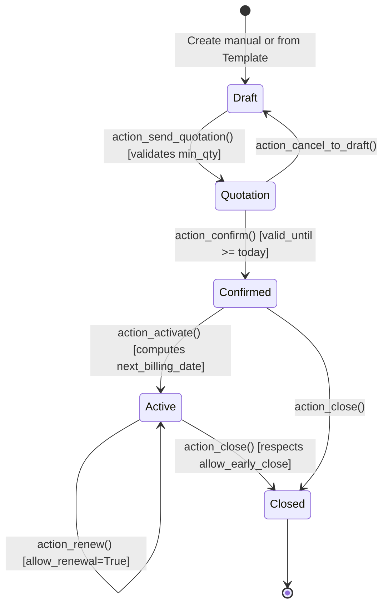

# Brightloop Subscription Management System — Module Documentation

**Workstream Lead:** Member 2 (Product, Plan, Quotation & Subscription Lifecycle Lead)  
**Module Name:** `brightloop_subscription`  
**Target Platform:** Odoo 18.0 Community / PostgreSQL 16 / Python 3.12  
**Assigned Branch:** `member-2`  

---

## 1. Executive Summary & Functional Scope

The `brightloop_subscription` module delivers the commercial backbone for Brightloop Software, orchestrating the entire lifecycle from product and variant setup, plan governance, and template-based quotations, to full recurring subscription activation, pause/resume, renewal, and closure.

All models and transition methods adhere strictly to the official problem statement and the platform architecture approved by Member 1 (`brightloop_core`).

---

## 2. Shared Data Contract Alignment

The module implements the canonical shared contracts defined in `documentation/ARCHITECTURE.md` and `addons/brightloop_core/models/shared_constants.py`:

| Logical Entity | Odoo Model | Canonical Fields |
| :--- | :--- | :--- |
| **Product** | `brightloop.product` | `id`, `name`, `product_type`, `sales_price`, `cost_price`, `notes`, `active`, `variant_ids` |
| **ProductVariant** | `brightloop.product.variant` | `id`, `product_id`, `name`, `price_adjustment`, `effective_price` |
| **Plan** | `brightloop.plan` | `id`, `name`, `billing_price`, `billing_interval`, `minimum_quantity`, `start_date`, `end_date`, `auto_close`, `allow_early_close`, `allow_pause`, `allow_renewal` |
| **Quotation Template** | `brightloop.quotation.template` | `id`, `name`, `plan_id`, `validity_days`, `line_ids` |
| **Subscription** | `brightloop.subscription` | `id`, `subscription_number`, `partner_id` / `customer_id`, `plan_id`, `status`, `start_date`, `expiry_date`, `next_billing_date`, `is_paused`, `renewal_count`, `line_ids` |
| **SubscriptionLine** | `brightloop.subscription.line` | `id`, `subscription_id`, `product_id`, `variant_id`, `quantity`, `unit_price`, `tax_id`, `amount_subtotal` |

---

## 3. Product & Variant Pricing Logic

* **Base Product:** Configurable sales price and cost price. Validates non-negative values (`sales_price >= 0.0`, `cost_price >= 0.0`).
* **Variant Price Adjustments:** Supports positive and negative price deltas.
* **Effective Price:**
  $$\text{effective\_price} = \text{product\_id.sales\_price} + \text{price\_adjustment}$$
* **Official Hackathon Example:**
  - Product base price: ₹5,000.00
  - Variant "Odoo Brand" adjustment: +₹560.00
  - Effective sales price: ₹5,560.00
* **Validation:** Rejects adjustments that result in negative final prices.

---

## 4. Subscription Plan Governance

Plans support all four canonical billing intervals:
* `daily`
* `weekly`
* `monthly`
* `yearly`

### Active Governance Permissions:
1. **`allow_pause`:** Controls whether active subscriptions can be paused. If `False`, `action_pause()` raises `UserError`.
2. **`allow_renewal`:** Controls whether subscriptions can be extended. If `False`, `action_renew()` raises `UserError`.
3. **`allow_early_close`:** Controls whether subscriptions can be terminated before `expiry_date`. If `False`, early closure raises `UserError`.
4. **`auto_close`:** When enabled, the automated closure cron (`_cron_auto_close_subscriptions`) automatically closes expired subscriptions.

---

## 5. Canonical Subscription Lifecycle



### Transition Specifications:
* **Unique Sequential ID:** Generated via sequence code `brightloop.subscription` $\rightarrow$ `SUB/%(year)s/NNNNN`.
* **Quotation Confirmation:** Validates `valid_until >= today`. Rejects expired quotes.
* **Activation:** Calculates initial `next_billing_date` and `expiry_date` using the plan's billing interval.
* **Pause & Resume:**
  - Paused contracts retain canonical `status = 'active'` with boolean flag `is_paused = True`.
  - On resume, `next_billing_date` and `expiry_date` are automatically shifted forward by the exact pause duration.
* **Renewal:**
  - Increments `renewal_count += 1` and extends `expiry_date` by the billing interval.

---

## 6. Cross-Module Integration Contracts

### Integration with Member 3 (`brightloop_billing`):
Member 3's recurring billing cron queries:
```python
due_subscriptions = self.env['brightloop.subscription'].search([
    ('status', '=', 'active'),
    ('is_paused', '=', False),
    ('next_billing_date', '<=', fields.Date.today()),
])
```
* **Accessible Fields:** `subscription_number`, `partner_id`, `plan_id`, `plan_id.billing_interval`, `next_billing_date`, and `line_ids` (`product_id`, `quantity`, `unit_price`, `tax_id`, `amount_subtotal`).
* **Post-Billing Callback:** Member 3 calls `subscription.action_advance_billing_date()` to increment `next_billing_date` for the subsequent cycle.

### Integration with Member 4 (`brightloop_finance`):
* **Model:** `brightloop.subscription`
* **Active KPI Query:** `self.env['brightloop.subscription'].search_count([('status', '=', 'active')])`
* **Customer Field Alias:** Both `sub.partner_id` and `sub.customer_id` are available for direct compatibility.

---

## 7. Security & Customer Row-Level Record Isolation

* **Groups Used:**
  - `brightloop_core.group_brightloop_admin`: Full administrative access.
  - `brightloop_core.group_brightloop_staff`: Operational management (products, plans, quotes, subscriptions).
  - `brightloop_core.group_brightloop_customer`: Restricted read-only portal access.
* **Record Rules (`subscription_security.xml`):**
  - Subscriptions: `[('partner_id', 'child_of', user.commercial_partner_id.id)]`
  - Subscription Lines: `[('subscription_id.partner_id', 'child_of', user.commercial_partner_id.id)]`
  - Prevents customer cross-tenant visibility.

---

## 8. Automated Test Suite Matrix

The module provides full automated test coverage in `addons/brightloop_subscription/tests/`:

| Test Suite | Scenario Tested | Status |
| :--- | :--- | :---: |
| `test_product.py` | Product creation, editing, negative price rejection | **VERIFIED** |
| `test_product.py` | Official variant adjustment (5000 + 560 = 5560) | **VERIFIED** |
| `test_product.py` | Excessive variant discount below zero rejection | **VERIFIED** |
| `test_plan.py` | All four billing intervals (daily, weekly, monthly, yearly) | **VERIFIED** |
| `test_plan.py` | Next billing date computation progression | **VERIFIED** |
| `test_plan.py` | Minimum quantity ($\ge 1$) & invalid dates validation | **VERIFIED** |
| `test_plan.py` | Governance permissions configuration | **VERIFIED** |
| `test_quotation.py` | Template creation and template lines | **VERIFIED** |
| `test_quotation.py` | One-click quotation generation from template | **VERIFIED** |
| `test_quotation.py` | Expired quotation confirmation rejection | **VERIFIED** |
| `test_quotation.py` | Minimum quantity enforcement on quotation send | **VERIFIED** |
| `test_subscription_lifecycle.py` | Unique sequence generation (`SUB/YYYY/NNNNN`) | **VERIFIED** |
| `test_subscription_lifecycle.py` | Canonical lifecycle transitions (`draft` $\rightarrow$ `closed`) | **VERIFIED** |
| `test_subscription_lifecycle.py` | Invalid lifecycle transitions rejection | **VERIFIED** |
| `test_subscription_lifecycle.py` | Pause & resume billing/expiry date shift | **VERIFIED** |
| `test_subscription_lifecycle.py` | Renewal permission check and renewal count | **VERIFIED** |
| `test_subscription_lifecycle.py` | Early closure permission enforcement | **VERIFIED** |
| `test_subscription_lifecycle.py` | Member 3 post-invoice date advance interface | **VERIFIED** |
| `test_subscription_lifecycle.py` | Automated closure cron | **VERIFIED** |
| `test_customer_isolation.py` | Customer self-read permitted, cross-tenant denied | **VERIFIED** |
| `test_customer_isolation.py` | Customer modification forbidden | **VERIFIED** |
